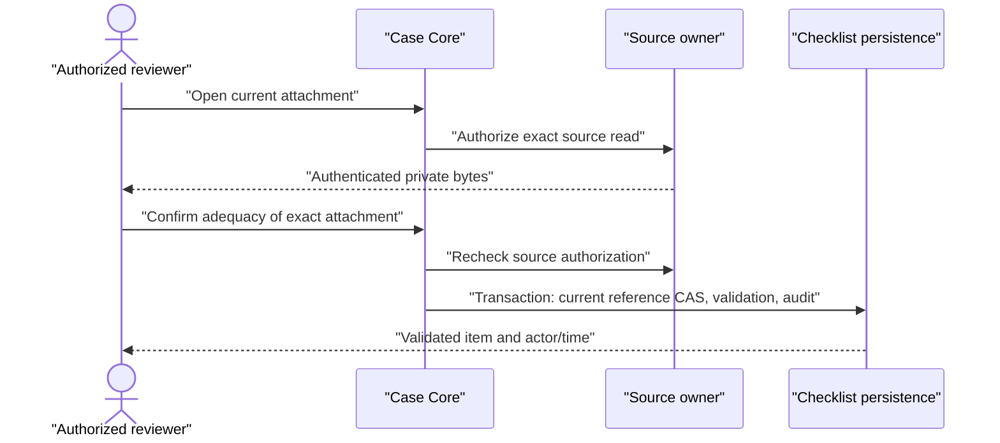

# Checklist document upload and selection

## Objective

Make Enviar documento and Selecionar documento existente functional for an unreceived checklist item. The operator confirms the inherited client, Case and requirement, supplies a file or chooses an authorized client document, and receives a durable association awaiting human adequacy review. Include the existing Formalização backend prerequisite so successfully completed stages can release signed artifacts.

## Scope

| Area / actor | Included | Excluded or deferred |
| --- | --- | --- |
| Current active, eligible Case Gestor/Colaborador | Upload, select, open and review the exact attachment | Team changes, Case opening and lifecycle migration |
| Client document collection | Confirmed Motor receipts, completed Consulta approved/current versions, completed Formalização preserved signed PDFs; source permission on every access | Drafts, other clients, source content permission grants, duplication of source bytes |
| Formalização prerequisite | Port the bounded existing backend signing/completion dependency closure; maintain atomic Intake contracting and preserved artifacts | Whole-branch merge, new signing channels, redesign of signing screens |
| Checklist UI | Two operational buttons and controlled upload/selection/review dialogs; dedicated read-only document page for Abrir documento; existing compact Pendentes/Atendidos list | Restore removed dossier, exception, activity, gate panels or header status chip |

Case REQ-008 and Engine REQ-022 upload/selection are delivered fully in this slice. Stage document release is delivered fully for the three named sources. The broader Formalização PRD is partially covered by the imported prerequisite: its historical email delivery scope is retained; expanding WhatsApp is outside this requested dependency closure.

## Behavior Contract

### Functional requirements

| ID | Source | Required behavior |
| --- | --- | --- |
| RF-01 | Case v8 REQ-008; user complete-flow decision | Active eligible Case members may attach only to their nonclosed Case's item. Actor, client, Case and item are server-derived; Admin read access alone grants no write. Documentary reads use a dedicated membership-based access intent, including closed Cases, without the operational Admin bypass. |
| RF-02 | Engine v11 REQ-022; Infrastructure Storage | Direct signed upload uses a unique immutable path, confirmed inherited client, author/time/channel and original name. MVP accepts the existing internal portal file policy: PDF/JPEG/PNG, 1 byte–10 MiB; bytes/type/size are verified before recording receipt. Internal uploads bypass AI/OCR, classification, duplicate detection and JSON organization; originals enter AwaitingValidation for explicit human review. Upload alone does not satisfy the requirement; an existing active waiver remains satisfied by waiver until human document validation. |
| RF-03 | Case v8 REQ-008; Production v17 12.6; Consulta v13 REQ-020; Formalização v10 REQ-017 | Selector lists only same-client readable sources. Consulta releases independently after completion and only approved/current versions; Formalização releases only after completion plus authoritative signed-PDF preservation. Collection association is durable and idempotently reconciled without copying bytes or generating Motor batches for produced documents. |
| RF-04 | Case v8 REQ-008; Engine v11 REQ-022 | Confirmation rechecks context, source access and current eligibility. It fixes the exact source version/artifact, retains previous attempts and audits actor/time. Upload/selection remains pending review regardless of source approval or previous Motor validation. An already waived item retains its waiver and Waived status while the new document awaits review. |
| RF-05 | Case v8 REQ-008; Production 12.7 | Open and per-item review enforce both Case and source permission. Human confirmation validates only the current exact association. For received files it also records the real human Valid decision, reviewer and time in Motor Documental atomically, so the client Documents tab shows Validado. The confirmed client and original source Case ownership remain unchanged; a missing legacy item link is filled only when its original Case matches, while differently-owned scalar links remain intact and the current exact relationship is recorded in audit. Global Valid never satisfies other checklist items. Background analysis cannot overwrite human-reviewed status or relationships. Produced approvals and signed artifacts remain unchanged. Later source versions never silently replace it. Source permission removal blocks future reads/reviews. |
| RF-06 | Engine REQ-022; both stage release requirements | Retry of the same actor-scoped operation reuses the receipt/association. Changed request with reused operation ID and stale item state conflict. Concurrent confirmations yield one current attachment and no partial audit/validation. Failed storage/publication permits recovery without deleting originals or reverting stage completion. |
| RF-07 | User references; Design; Case REQ-008 UX | Preserve teal pill buttons, compact rows and required/optional text. Dialogs show target context, explicit confirmation, pending, empty and recoverable failure states. Keyboard focus is contained/restored; narrow screens have no horizontal overflow. Abrir documento on fulfilled items navigates to a dedicated read-only page for the exact association; it never opens editable validation or pending-message controls. PDF/images are previewed safely, DOCX uses the existing safe preview/download capability, and unsupported formats offer download only. Loading, denied/missing content and retry are explicit; back navigation returns to the Case. |

| RF-08 | Case v8 REQ-008/009/010/016; user live waiver decision | Current active eligible Gestor may waive an unresolved required item with explicit confirmation and trim-nonblank justification, including when acting alone. Waiver is a distinct persisted satisfied state with actor/name/time, not a document validation. Active Gestor may revoke to pending. Later attachment preserves waiver; exact human document validation substitutes it. Grant/revoke/substitution are atomic and audited; closed Cases are read-only and Admin receives no write permission. |
| RF-09 | User request to fix the case-list checklist column; Case v8 REQ-007 | `GET /cases/my` returns each authorized Case's persisted mandatory checklist progress. Validated and waived required items count as complete; pending and in-analysis items remain incomplete; optional items are excluded. Cases without persisted checklist items omit progress rather than inventing a template total. The server uses one batched status-count query for the authorized cases, not one checklist request per row. |

| RF-10 | User decision2026-10-13; Engine REQ-022 contextual human association | InternalUpload receipts through both checklist completion and generic internal-upload creation require no AI/OCR publication or processing acceptance. Verification of file bytes/type/size remains mandatory; receipt/association stay atomic and idempotent and wait for human validation. Manual AI reprocessing of an internal receipt is rejected before mutation/publication. Previously queued processing and JSON events consult persisted origin channel and skip internal receipts before workflow/model/failure writes; events cannot opt into processing by supplying another channel/path. Daily-client reuse must match the same persisted channel; internal and external receipts cannot share a batch. Existing generic upload triage/client rules remain unchanged. External receipt processing remains unchanged. Client Documents renders historical internal Processing/ProcessingFailure as awaiting human validation while retaining genuine human validation and other outcomes. |

### Acceptance criteria

| ID | Requirements | Given / when | Observable result | Checks |
| --- | --- | --- | --- | --- |
| CA-01 | RF-01, RF-02, RF-04 | Member confirms a supported upload to an unreceived item | One private receipt and immutable Case-item association, absent from client collections until validation; an unwaived item stays pending with Documento recebido — revisar; an already waived item retains waiver until human validation; no fabricated validation metadata | AUTO-01, MAN-01 |
| CA-02 | RF-01 | Anonymous, Admin-only, removed/inactive/ineligible member, closed Case or foreign item attempts mutation | 401/403/404 as applicable, no receipt or association mutation | AUTO-02 |
| CA-03 | RF-03 | Sources include completed/noncompleted stages, current/old/unapproved versions, preserved/missing artifacts, another client and inaccessible origin | Only completed, eligible, readable same-client sources listed; Consulta does not wait for Formalização; durable release contains exact source keys | AUTO-03, MAN-02 |
| CA-04 | RF-04, RF-05 | Existing source selected, then origin changes its current version | Checklist fixes original version and stays pending; subsequent read/review uses the fixed source and source authorization | AUTO-04, MAN-02 |
| CA-05 | RF-05 | Authorized operator opens the exact association and confirms adequacy | Only that current item becomes validated with actor/time; received original also shows Validado for its confirmed client with human audit, preserved origin access and no duplicate bytes. Client cached batches refresh after success. Historical/global source validation cannot bypass review of another item; failure rolls back all effects | AUTO-05, MAN-03 |
| CA-06 | RF-06 | Same operation retried, payload differs, item changed or two confirmations race | Retry returns prior committed result without another file/relation; differing payload/stale/racing write returns 409 and atomic effects | AUTO-06 |
| CA-07 | RF-02, RF-06 | Empty/oversized/spoofed/unsupported file, missing upload object or storage failure | Clear recoverable failure, no false receipt or satisfaction; existing confirmed original retained without requiring AI availability | AUTO-07, MAN-01 |
| CA-08 | RF-07 | Buttons/dialogs used at desktop and 390×844 via keyboard | Correct target context, selection/confirmation, disabled duplicate submit, retained input on error, cancellation without relation, focus restoration and no overflow | AUTO-08, MAN-01, MAN-02, VIS-01 |
| CA-09 | RF-03, RF-06 | Signing completion and Intake contracting occur or compete with closure | Existing prerequisite completion invariants hold; client publication cannot expose in-progress or partial signing and cannot roll back completion | AUTO-09 |

| CA-10 | RF-08, RF-06, RF-07 | Gestor confirms a required-item waiver, views its justification, revokes it or later validates an attached document | Waived item displays Atendido por dispensa and fulfills mandatory gates without fabricated file/reviewer metadata; real reason/actor/time survives reload and audit; revoked returns pending; later document validation replaces waiver; unauthorized/closed/optional/blank/stale requests have no effects | AUTO-12, MAN-05, VIS-01 |
| CA-11 | RF-09 | Lawyer lists authorized cases with required items in validated, waived, pending and in-analysis states, optional items, and a case with no persisted checklist | Each response row reports completed-required/total-required counts for its own Case; waived counts as complete, optional is excluded, no-checklist progress is omitted, and authorization/filter behavior is unchanged | AUTO-13, MAN-06 |

| CA-12 | RF-02, RF-10 | Internal upload confirmed, retried or targeted by queued/manual AI work | One confirmed original and pending checklist association; no processing/JSON publication, workflow/model call or processing mutation. Manual reprocess400 with explanatory message. External processing retains its existing path; client internal failure badge becomes Aguardando validação and human Valid remains Validado | AUTO-14, MAN-07 |

Visual commitments and approved responsive/dialog adaptations are in [design/handoff.md](design/handoff.md).

### Deferred client publication — direct request 2026-10-13

RF-11: A file uploaded through a checklist belongs to the Case item while awaiting human review. It is absent from the client Documents tab and every existing-document selector until the originating item is explicitly validated. A waiver, upload completion, attachment, AI analysis or independent Motor decision does not publish it. Existing client files and independently completed Consulta/Formalização sources retain their current availability rules.

CA-13: After upload, the original is readable by authorized members of its originating Case for review, the batch has no public client link, and client lists/other-item selectors omit it. Validating the exact originating association atomically sets the item to Validated, links the original receipt to the client and records genuine Motor review/audit. Replay publishes once. CAS, permission, source, review or audit failures leave the pending batch unlinked. Pending files cannot be attached to another item by guessing their registry ID. Checks: AUTO-15, MAN-08.

### Required/optional choice for added items — revision7

RF-12: When an eligible current member adds a checklist item to an active Case, the dialog offers a labelled checkbox `Item obrigatório`, checked by default. Unchecking creates an optional pending item. Existing permissions and closed/Admin read-only behavior remain unchanged. Optional items are excluded from mandatory progress and documentary production/closure gates; adding a mandatory pending item still does not revoke already released production. The user's current request extends PRDv8 REQ-007's “obrigatório por padrão”; no external write is authorized.

CA-14: Opening/reopening defaults required=true; explicit false persists after reload and displays Opcional. Required true/false and omitted=true are supported; strings/null/numbers are rejected by the shared strict schema. Same actor/key/title/normalized flag replays one item/history; a changed title or required flag conflicts409 even in insert-race fallback. Immutable history records the persisted flag. Name/flag remain after failure; pending disables fields/close/duplicate writes; cancellation is inert. Accessible keyboard checkbox/label and390px dialog are usable, and dynamic consequence copy reflects the selected flag. Checks AUTO-16/MAN-09/VIS-01, required mutation AUTO-10 remains Blocked.

## Technical Contract

### Deferred publication architecture and runtime

Modify Core CompleteClientDocumentUploadUseCase to create an InternalUpload batch without clientId and with the immutable Case/item file context. The private client_documents registry retains bound clientId as an authorization context, not a published collection entry. The public client collection is the confirmed batch association; selectors reconcile only public origins.

Modify ClientDocumentUploadsRepository with `findByStoragePath(storagePath: string): Promise<ClientDocumentUpload | undefined>`. ResolveReceivedClientDocumentUseCase receives that port and may resolve a completed pending upload only for `forSelection: false`, matching its immutable client and originating Case. Public selection still requires the client-linked batch. AttachChecklistDocumentUseCase uses the private read capability for upload completion and the public selector capability for existing selection.

Modify DocumentBatchesRepository with `publishChecklistUpload(request: { documentId: string; fileId: string; clientId: string; caseId: string; checklistItemId: string; reviewedAt: Date }): Promise<boolean>`. Its Server implementation uses the ambient transaction and atomically updates the batch only for a completed upload bound to the supplied file/client/Case/item . An existing identical client link is idempotent; a conflicting binding is rejected. Case-owned ValidateChecklistDocumentUseCase provides the exact current association proof through its successful item CAS; the DocumentEngine repository never reads Case tables. ConfirmReceivedClientDocumentReviewUseCase receives this port and publishes receipts after that CAS, before genuine file review/audit, all inside ValidateChecklistDocumentUseCase's serializable transaction. Publication, item status, review, operation and history commit or roll back together. Retained source ownership is never changed.

Pin original uploaded Case/item during analysis projection/writes. Direct Motor decisions on an unlinked InternalUpload are rejected before mutation with an instruction to validate through the owning checklist. No AI job or broker publication is added.

Add nullable `ClientDocumentUpload.publishedAt?: Date` / `client_document_uploads.published_at` as a durable publication marker, set once in the same transaction as client batch linkage and exact item validation. Generate migration 0069 and backfill this marker only from genuinely current/historical validated exact associations; detach other previously client-linked checklist upload batches, preserving originals, private references, history, accounts and ordinary receipts. Shared migration may read existing Case evidence for this reconciliation; runtime DocumentEngine repositories only read their owned tables. No historical migration rewrite. Client batch reads hide checklist uploads lacking the publication marker; private reads remain available to the originating Case.

AUTO-15: Core receipt/resolution/review tests cover no client link, private originating-Case reads, guessed-ID/foreign-Case selection rejection, atomic publication conflict and idempotency. Native checklist attach/validate HTTP tests assert client batch and selector absence before validation, presence once after validation, authentic reviewer/audit, exact bytes, failure rollback and existing source behavior. Data migration is checked against pending, historically/currently validated, ordinary receipts and repeat execution. Affected Core/Server types and scoped Biome must pass. Mutation runner remains blocked under existing AUTO-10.

MAN-08: With healthy real services, upload through a pending checklist item, verify authorized originating-Case members can read it for review and both client Documents/selector omit it; validate it, then verify client Documents and selector contain it once, with correct name/reviewer/time and original bytes. Cancel/read navigation sends no writes. Use Playwright CLI, fresh authenticated actor, desktop and narrow keyboard path. No design layout change is required.


### Dedicated document review presentation

User correction on2026-10-13 moves the exact association review from a modal to the existing canonical lawyerCaseChecklistItem route `/advogado/meus-casos/$caseId/checklist/$checklistItemId`. Direct navigation/reload resolves current actor-scoped Case/item and exact reference; legacy items retain their existing detail page. Referenced items do not issue legacy Motor file/log queries. The page provides a larger PDF/image preview or safe download, context and explicit adequacy checkbox, validation/error/refresh/pending handling and replacement upload/selection dialogs. Validated/closed items remain read-only and no role/source permissions change. Back navigation returns to the canonical case route with validated `tab=checklist` search. Browser Back/direct reload must retain correct target/permission/state; switching/replacing the attachment clears review acknowledgement. Upload/selection still remain modal. Owning page/widget, existing row navigation and route search contracts implement the change; reuse existing REST/CAS/review hooks. AUTO-08, MAN-03 and VIS-01 cover page navigation, reload, read errors/retry, replacement, validation, readonly state, mobile and keyboard.

### Case-list checklist progress response

Extend the existing authenticated `GET /cases/my` response with optional `checklistProgress: { completedCount: number; totalCount: number }`. `ListMyLegalCasesUseCase` first filters cases through the existing active-collaborator and Case-content authorization checks, then requests grouped checklist status counts only for those case IDs. It derives the required-item total and completed count in Core, counting `validated` and `waived` as satisfied and excluding optional rows. A Case without persisted checklist rows omits the field. The Drizzle repository groups by Case, required flag and canonical item status in one query; it returns no document names, waiver reasons, file IDs or other item data. The Web list maps this response to its existing progress cell and displays an em dash when no checklist data exists. No new permission, mutation, migration, or separate per-row request is introduced.

Expected declarations:

```typescript
export type CaseChecklistItemStatusCount = {
  caseId: string
  isRequired: boolean
  status: CaseChecklistItemStatus
  count: number
}

// CaseChecklistItemsRepository
listStatusCountsByCaseIds(caseIds: readonly string[]): Promise<readonly CaseChecklistItemStatusCount[]>

// LegalCaseSummary gains this optional read-model field
checklistProgress?: { completedCount: number; totalCount: number }
```

The controller documents the array response with a summary DTO including the optional progress shape. Automated proof covers Core derivation, real PostgreSQL-backed `GET /cases/my` serialization and Web row rendering; the existing authenticated list journey remains the browser boundary.

### Architecture Mapping

Owners: Case Management owns attachment/adequacy; Motor Documental owns received originals and client collection references; Consulta, Produção Documental and Formalização expose source-owned documentary capabilities. Shared integration composes those public boundaries, without importing another module's database models into feature repositories. Business decisions remain Core use cases. The historical Formalização backend port is dependency maintenance; new release/checklist behavior follows this contract.

| Action | Boundary | Element / Path | Required change |
| --- | --- | --- | --- |
| Modify | Core | `document-engine/use-cases/create-document-batch-use-case.ts`, owning test and `DocumentBatchesRepository.findDailyByClient` | Force internal manual review independently of skipProcessing request; channel-scoped daily reuse |
| Create | Server | `document-engine/fixtures/document-engine-processing-fixture.ts` and `document-engine/messaging/inngest/jobs/tests/internal-upload-ai-exclusion-flow.test.ts` | Isolated actual Inngest completion proof for internal exclusion and preserved external processing |
| Modify | Core | `case-management/use-cases/add-case-checklist-complementary-item-use-case.ts`, owning test and `interfaces/case-management-service.ts` | Default/persist/audit required flag; include normalized flag in replay fingerprint |
| Modify | Validation | `case-management/schemas/add-checklist-item-schema.ts`, owning test | Shared strict boolean defaulttrue for form and HTTP |
| Modify | Server | Add-item controller/owning test and `rest-client/case-management/cases.rest` | Swagger/default examples; real persistence/history/progress/replay proof |
| Modify | Web | Existing checklist `add-item-dialog/{index.tsx,use-add-item-dialog.ts}` and three owning tests | Labelled required checkbox/default, dynamic copy, explicit payload, pending/retry state |
| Create | Web | Internal `add-item-dialog/{header,fields}/index.tsx` | Pure typed composition retaining existing markup; behavior/tests owned by parent dialog |
| Modify | Server | `document-engine/database/drizzle/repositories/document-batches-repository.ts`, generic internal-upload controller/tests | Optional canonical channel predicate on daily lookup; HTTP proofs of internal no-publication and cross-channel isolation |
| Create | Core | `document-engine/use-cases/should-process-document-file-use-case.ts`, owning test and use-case export | Persisted file/batch/channel eligibility; reject internal/missing/mismatched receipts |
| Modify | Core | `document-engine/use-cases/complete-client-document-upload-use-case.ts`, owning test | AwaitingValidation receipt, six ports, no Broker/clock/publication or processing-acceptance write |
| Modify | Core | `document-engine/use-cases/reprocess-document-file-use-case.ts`, owning test | InternalUpload400 after existing authorization, before processing/publication |
| Modify | Server | `document-engine/provision/client-documents-provision.module.ts` | Align completion six-port factory injection and remove unused messaging dependency |
| Modify | Server | `document-engine/messaging/inngest/jobs/{process-document-file-job,organize-document-file-json-with-ollama-job}.ts`, owning tests and existing late-analysis flow fixture | Durable Core eligibility before actual workflow/model/failure persistence; production registration unchanged |
| Modify | Web | `identity/widgets/pages/client-details-page/client-documents-tab/document-batch-card/{index.tsx,use-document-batch-card.ts}`, owning tests | Channel-aware legacy Internal Processing/ProcessingFailure awaiting-human-review label |
| Create | Core | `ClientDocument` in `packages/core/src/document-engine/domain/entities/client-document.ts`, source/ticket structures in separate files | Discriminated immutable references and transport metadata; export structure barrel |
| Create | Core | `ClientDocumentsProvider` in `packages/core/src/document-engine/interfaces/client-documents-provider.ts` | List/reconcile, resolve, read, prepare/complete contextual upload capabilities; source permission remains mandatory |
| Modify | Core | `CaseChecklistItem` in `packages/core/src/case-management/domain/entities/case-checklist-item.ts` | Add optional documentReference; retain documentFileId only for real Motor file IDs; creation omits reference |
| Create | Core | Checklist document operations/use cases under `packages/core/src/case-management/use-cases/` and interfaces | List, prepare upload, attach, read and validate with transaction/idempotency/CAS contracts |
| Modify | Core | `ListCaseChecklistUseCase`, `CaseTeamManagementService` and structure/interface/use-case barrels | Preserve generated attachments through template synchronization; expose matching client service signatures |
| Modify | Core / Server / Web | `CaseChecklistItemsRepository`, `ListMyLegalCasesUseCase`, `GET /cases/my`, `LegalCaseSummary`, `use-my-cases-list-presentation.ts` | Batch grouped persisted item status counts for authorized cases; return and render mandatory completion without hardcoded totals |
| Create / Modify | Core / Server | Source-owned query capabilities under Consulta, Document Production and Formalização | Query completed contexts by client; resolve exact produced version/artifact and authorization through public owner providers, never use produced UUIDs as Motor files |
| Create | Server | Client-document persistence/provider under `apps/server/src/document-engine/database/` and `apps/server/src/document-engine/provision/` | Durable unique release relation, contextual upload session/receipt, source catalog integration |
| Create / Modify | Server | Checklist document repository/model/controller/provider plus `apps/server/src/case-management/case-management.module.ts` | Atomic association history/current reference/review/operation, AuthGuard and current Case permission; register providers and controllers |
| Modify | Core / Server | `StorageProvider` and `SupabaseStorageProvider` | Add signed upload and object inspection without changing legacy upload consumers; `upsert:false` unique paths, no permanent public read URLs |
| Create / Modify | Validation | `packages/validation/src/case-management/schemas/checklist-document-schema.ts` and barrels | Strict request union, UUIDs, names, supported media/size, operation/version syntax; business authorization stays Core |
| Modify | Server | `apps/server/src/shared/database/drizzle/schema.ts`, generated migrations and target metadata | Include complete source-owned tables; generate after all models stabilize, inspect SQL and apply only disposable fixtures |
| Modify | Server | Prerequisite Formalização/Intake/Document Production/shared provision and `apps/server/package.json`, `pnpm-lock.yaml` | Bounded lifecycle dependency closure from `codex/formalization-completion-backend`; resend 6.25.0 in approved stack; additive composition preserving current Case/telemetry |
| Modify | Web | `apps/web/src/rest/services/case-management-service.ts` | Bearer-authenticated service parity for new endpoints; signed bytes upload via existing Supabase/browser capability |
| Create | Web | `apps/web/src/ui/case-management/hooks/` and widgets/components/checklist-document-dialog | Domain query/mutation hooks; local dialog state hook and declarative render; source search/selection, upload and retry |
| Modify | Web | Existing `my-case-page/checklist-dossier-tab`, `hooks/use-case-checklist.ts`, `types.ts` | Activate buttons and review/open for all source kinds; preserve earlier layout removals; never inherit source validation into attachment status |
| Create / Modify | Web | `apps/web/tests/case-management/checklist-document-flows-page.test.ts`, fixtures and component/service tests | Observable route, request/cache/error/keyboard/mobile coverage |

### Waiver architecture and runtime amendment

Case owns the waiver: modify checklist status/entity/repository, Core grant/revoke and owning gate/synchronization consumers, Validation request schemas, Server item model/mapper/operation replay/history controllers and an additive migration; Web owns manager-only button/dialog, persisted mapping/progress and fulfilled justification/revoke actions. Existing original-file and source-permission boundaries remain.

```typescript
export const CaseChecklistItemStatus = { Pending: 'pending', InAnalysis: 'in_analysis', Validated: 'validated', Waived: 'waived' } as const
export type ChecklistDocumentWaiver = { justification: string; actorId: string; actorName: string; grantedAt: Date }
// CaseChecklistItem declaration additionally contains: waiver?: ChecklistDocumentWaiver
```

POST `/cases/:caseId/checklist/items/:checklistItemId/waiver` accepts strict `{ justification: string, operationId: UUID, expectedUpdatedAt: ISO timestamp }`; POST same path plus `/revocation` accepts `{ operationId: UUID, expectedUpdatedAt: ISO timestamp }`. Both return201/fullitem. Grant permits only Pending/InAnalysis required items; trims justification and rejects blank/optional400 and already Waived/document-validated states409. Same-operation replay returns the previously committed result, while a new operation cannot overwrite an active waiver reason. Regrant is valid only after revocation. ManageDocumentException authorizes active eligible currentManager against a nonclosed Case; grantor name is server-derived from the owning collaborator port. Single-manager selfconfirmation is allowed. Foreign/missing Case/item404, unauthorized403/anonymous401, stale/reused different operation409.

Inside the existing serializable transaction, reauthorize/read, check actor-scoped operation replay/fingerprint and expected item revision, replace current item byCAS, append genuine waiver history and save operation result. Grant setsWaived and waiver, clears validation metadata and retains any real source association. Revoke removes waiver and setsPending while retaining originals. Upload/selection of a waived item retains waiver/status until explicit document validation atomically clears waiver and records substitution. History stores true waiver snapshots for grant/revoke and real reference plus snapshot for substitution. No fake document references or validation actor/time are created.

Persist nullable JSON waiver plus canonical enumvalue; operation kind discriminator `document|waiver` defaultsdocument for legacy rows, so no-document waiver replay is valid while corrupted document replay stays rejected. Additive migrations preserve existing data/journal; avoid using a newly-added enum literal in same transaction constraints (compare status::text where needed). Waived state requires real nonblank justification/actor/time. Core approval/homologation/generation required-item sufficiency and repository pending checks accept validated ORwaived; generation selected-file predicates still require actual validated files. Core/SQL template synchronization preserves active waivers, including waiver committed after snapshotSELECT. Legacy Motor propagation cannot overwrite waived rows.

Dialog shows Case/client/item, required justification, explicit confirmation, pending/error/retry and cancellation without effects. Manager capability is derived from current active eligible member role, never Admin canManage alone. Persisted waiver appears in Atendidos bydispensa with Verjustificativa; revoke available to Gestor only while nonclosed. Optional item has no waiver action. Closed/Admin views may read justification. Mobile390×844 and keyboard paths retain visible actions/focus.

Read-only page architecture: create `apps/web/src/ui/case-management/widgets/pages/checklist-document-page/` and protected `/advogado/meus-casos/$caseId/checklist/$checklistItemId/documento` route using typed ROUTES navigation. Resolve the requested current checklist item before reading bytes: new documentReference uses the existing Case exact-document read endpoint; legacy documentFileId uses existing authenticated Motor metadata/content APIs. File preview/object URLs use safe media policy and are released on identity change/unmount. Cache identity includes the actor and association, and failure clears prior content. Fulfilled row navigation uses this page; pending review and existing checklist item detail are retained. No new API/permission grant or mutation is introduced.

Expected consequential declarations (ordinary helpers may vary under the owning rules):

```typescript
export type ClientDocumentSource =
  | { readonly kind: 'received_file'; readonly fileId: string }
  | { readonly kind: 'consultation_version'; readonly consultationId: string; readonly documentId: string; readonly versionId: string }
  | { readonly kind: 'formalization_signed'; readonly formalizationId: string; readonly requestDocumentId: string; readonly artifactId: string }

export type ClientDocument = Entity & {
  clientId: string
  name: string
  mimeType: string
  sizeBytes?: number
  createdAt: Date
  source: ClientDocumentSource
}

export type ChecklistDocumentReference = {
  readonly clientDocumentId: string
  readonly source: ClientDocumentSource
  readonly attachedAt: Date
  readonly attachedBy: string
}

export type ChecklistUploadContext = {
  caseId: string
  checklistItemId: string
  clientId: string
  actorId: string
}

export type ChecklistUploadTicket = {
  uploadId: string
  signedUrl: string
  token: string
  path: string
  bucket: string
  expiresAt: Date
  alreadyUploaded: boolean
}

export type PrepareChecklistUpload = ChecklistUploadContext & {
  operationId: string
  name: string
  mimeType: string
  sizeBytes: number
}

export interface ClientDocumentsProvider {
  listAvailable(request: { clientId: string; actorId: string; caseId: string }): Promise<readonly ClientDocument[]>
  resolve(request: { clientId: string; actorId: string; caseId: string; documentId: string; forSelection: boolean }): Promise<ClientDocument>
  read(request: { clientId: string; actorId: string; caseId: string; documentId: string }): Promise<{ document: ClientDocument; bytes: Uint8Array }>
  prepareUpload(request: PrepareChecklistUpload): Promise<ChecklistUploadTicket>
  completeUpload(request: ChecklistUploadContext & { uploadId: string }): Promise<ClientDocument>
  confirmReceivedReview(request: { documentId: string; clientId: string; caseId: string; checklistItemId: string; actorId: string; reviewedAt: Date }): Promise<void>
}

export type ChecklistDocumentAction =
  | { kind: 'existing'; documentId: string; operationId: string; expectedUpdatedAt: string }
  | { kind: 'upload'; uploadId: string; operationId: string; expectedUpdatedAt: string }

export type ChecklistDocumentRequest = {
  caseId: string
  checklistItemId: string
  actorId: string
}

export interface ChecklistDocumentTransactionProvider {
  runInTransaction<T>(operation: () => Promise<T>): Promise<T>
}
```

`CaseChecklistItem` modification is partial: existing members unchanged; add `documentReference?: ChecklistDocumentReference` and omit it from creation. JSON transport dates are ISO strings; domain consumers explicitly hydrate. `documentFileId` is undefined for produced documents; name remains populated for all sources. No shape masquerades as a Motor file.

Use-case signatures:

```typescript
ListChecklistDocumentsUseCase.execute(request: ChecklistDocumentRequest): Promise<readonly ClientDocument[]>

PrepareChecklistDocumentUploadUseCase.execute(request: ChecklistDocumentRequest & Omit<PrepareChecklistUpload, keyof ChecklistUploadContext>): Promise<ChecklistUploadTicket>

AttachChecklistDocumentUseCase.execute(request: ChecklistDocumentRequest & ChecklistDocumentAction): Promise<CaseChecklistItem>

ReadChecklistDocumentUseCase.execute(request: ChecklistDocumentRequest): Promise<{ document: ClientDocument; bytes: Uint8Array }>

ValidateChecklistDocumentUseCase.execute(request: ChecklistDocumentRequest & { operationId: string; clientDocumentId: string; expectedUpdatedAt: string }): Promise<CaseChecklistItem>
```

Core constructors depend on LegalCasesRepository, CaseChecklistItemsRepository, CaseAccessProvider, ClientDocumentsProvider, a checklist operation/history repository, transaction provider and server clock as needed. New repository capabilities include exact `(caseId,itemId)` lookup, atomic compare-and-set of current association/validation, and unique `(caseId,actorId,operationId)` operation lookup/insert with canonical request fingerprint and stored result. Failures roll back item/history/operation together. Reused operation with different fingerprint conflicts; identical completed operation returns its stored result only after current authorization.

Storage extension is complete below; new metadata/ticket structures each have their own file under `shared/domain/structures`, without exposing SDK types:

```typescript
export type StorageUploadTicket = {
  signedUrl: string
  token: string
  path: string
  bucket: string
  expiresAt: Date
}

export type StorageObjectMetadata = {
  mimeType: string
  sizeBytes: number
}

export interface StorageProvider {
  upload(path: string, file: Uint8Array, mimeType: string): Promise<string>
  download(path: string): Promise<Uint8Array>
  remove(path: string): Promise<void>
  createSignedUpload(path: string): Promise<StorageUploadTicket>
  inspect(path: string): Promise<StorageObjectMetadata | undefined>
}
```

`createSignedUpload` uses Supabase `createSignedUploadUrl` with `upsert:false`; its SDK-fixed two-hour lifetime is recorded. `inspect` returns undefined for absence only, never masks operational errors. Adapter metadata reads use installed SDK object info (or supported list metadata on older test Storage versions with exact path lookup); Core confirms size/type and downloaded magic bytes. The browser uses the returned capability for direct PUT without server session credentials. Paths use random upload IDs, never user filenames. Legacy server upload remains compatible; new direct upload cannot overwrite its object.

Source owners expose the following Core use cases and owner structures (one exported declaration per file, structure fields readonly). Their Server implementations supply repositories/storage adapters, not business decisions:

```typescript
export type ConsultationClientDocument = {
  readonly consultationId: string
  readonly clientId: string
  readonly documentId: string
  readonly versionId: string
  readonly name: string
  readonly fileId: string
  readonly storagePath?: string
  readonly mimeType: string
  readonly createdAt: Date
}

export type FormalizationClientDocument = {
  readonly formalizationId: string
  readonly clientId: string
  readonly documentId: string
  readonly requestDocumentId: string
  readonly artifactId: string
  readonly privateFileId: string
  readonly name: string
  readonly mimeType: string
  readonly sizeBytes: number
  readonly createdAt: Date
}

ListConsultationClientDocumentsUseCase.execute(request: { clientId: string; actorId: string }): Promise<readonly ConsultationClientDocument[]>

ResolveConsultationClientDocumentUseCase.execute(request: { clientId: string; actorId: string; consultationId: string; documentId: string; versionId: string; forSelection: boolean }): Promise<ConsultationClientDocument>

ListFormalizationClientDocumentsUseCase.execute(request: { clientId: string; actorId: string }): Promise<readonly FormalizationClientDocument[]>

ResolveFormalizationClientDocumentUseCase.execute(request: { clientId: string; actorId: string; formalizationId: string; requestDocumentId: string; artifactId: string; forSelection: boolean }): Promise<FormalizationClientDocument>
```

Modify `ConsultationsRepository` and `FormalizationsRepository` with `findByClientId(clientId: string): Promise<readonly OwnerEntity[]>`, all existing members unchanged. Add `FormalizationSignatureArtifactsRepository.findById(artifactId: string): Promise<FormalizationSignatureArtifact | undefined>` for pinned resolution. Owner use cases check current actor active/eligible assigned lawyer and exact client; list/selection additionally check source completed and eligibility. Consulta follows package context→included document→exact DocumentVersionsRepository.findById, requires approved/current for new selection and approved exact historical version for existing attachment reads. Formalização follows its current authoritative request→confirmed request-document→preserved signed_pdf artifact, with exact artifact/request linkage and completed state for selection. Historical exact reads preserve source state/evidence and source ownership; do not use the source reader's current-version fallback. Private bytes come from owner FileStorageProvider or Motor StorageProvider, never guessed IDs/paths.

Motor Core owns `ListClientDocumentsUseCase`, `ResolveClientDocumentUseCase`, `PrepareClientDocumentUploadUseCase`, `CompleteClientDocumentUploadUseCase` and `ReadClientDocumentUseCase`, mirroring the list/resolve/read/upload ClientDocumentsProvider signatures above, with one adjacent test file each. A Server `ClientDocumentsProvider` adapter delegates to them. A composed `ClientDocumentOriginsProvider` delegates produced list/resolve to the four owner use cases above, and byte delivery to storage; it is capability composition only. Motor use cases own confirmed receipt eligibility, durable release key generation/reconciliation, upload lifecycle/verification and source dispatch. They recheck origin permission for every list/resolve/read. Origin adapters do not grant new content access. Existing unauthenticated legacy batch list is not used as the new selector's security boundary. For Motor sources, current eligible Case content access for the confirmed same client is the collection read capability; any explicitly Case-restricted source attachment also rechecks access to its originating Case through the public Case access port. Actor/client/Case access predicates remain Core-owned. All legacy checklist linking/in-analysis/global-validation update methods must avoid overwriting any item with a new documentReference; source processing/global approval cannot mutate a per-item review result.

```typescript
export type ClientDocumentOrigin = Omit<ClientDocument, 'id'>

export interface ClientDocumentOriginsProvider {
  list(request: { clientId: string; actorId: string; caseId: string }): Promise<readonly ClientDocumentOrigin[]>
  resolve(request: { clientId: string; actorId: string; caseId: string; source: ClientDocumentSource; forSelection: boolean }): Promise<ClientDocumentOrigin>
  read(request: { clientId: string; actorId: string; caseId: string; source: ClientDocumentSource }): Promise<Uint8Array>
}

export interface ClientDocumentsRepository {
  findById(documentId: string): Promise<ClientDocument | undefined>
  listByClientId(clientId: string): Promise<readonly ClientDocument[]>
  add(request: { sourceKey: string; origin: ClientDocumentOrigin }): Promise<ClientDocument>
}

export type ClientDocumentUpload = Entity & PrepareChecklistUpload & {
  storagePath: string
  createdAt: Date
  expiresAt: Date
  clientDocumentId?: string
}

export interface ClientDocumentUploadsRepository {
  findById(uploadId: string): Promise<ClientDocumentUpload | undefined>
  findByOperation(request: ChecklistUploadContext & { operationId: string }): Promise<ClientDocumentUpload | undefined>
  add(upload: ClientDocumentUpload): Promise<ClientDocumentUpload>
  replace(uploadId: string, changes: { expiresAt?: Date; clientDocumentId?: string }): Promise<void>
}

export type ChecklistDocumentOperation = Entity & {
  caseId: string
  actorId: string
  operationId: string
  fingerprint: string
  result: CaseChecklistItem
  createdAt: Date
}

export type ChecklistDocumentHistory = Entity & {
  caseId: string
  checklistItemId: string
  action: 'attached' | 'validated'
  reference: ChecklistDocumentReference
  actorId: string
  createdAt: Date
}

export interface ChecklistDocumentOperationsRepository {
  find(request: { caseId: string; actorId: string; operationId: string }): Promise<ChecklistDocumentOperation | undefined>
  add(request: Omit<ChecklistDocumentOperation, 'id'>): Promise<void>
}

export interface ChecklistDocumentHistoriesRepository {
  add(request: Omit<ChecklistDocumentHistory, 'id'>): Promise<void>
}
```

CaseChecklistItemsRepository receives these additional signatures (unchanged omitted members retained):

```typescript
findById(caseId: string, checklistItemId: string): Promise<CaseChecklistItem | undefined>

replace(checklistItemId: string, changes: {
  status: CaseChecklistItemStatus
  documentReference?: ChecklistDocumentReference
  documentFileName?: string
  documentFileId?: string
  validatedAt?: Date
  validatedBy?: string
  updatedAt: Date
}, expected: { caseId: string; updatedAt: string; clientDocumentId?: string }): Promise<CaseChecklistItem | undefined>

```

Collection/upload `add` returns the existing identical unique-key record on duplicate insertion; changed metadata is rejected by Core after lookup. Checklist item `replace` replaces the entire documentary subset, maps omitted optional values to database null and checks expected Case/revision/reference atomically; Core decides status and fields. Derive updatedAt strictly above the previous API millisecond revision even with equal/backward clock, and test sub-millisecond persisted tokens. The transaction adapter promises serializable isolation for its callback; it preserves any existing ambient serializable executor and does not silently nest a weaker transaction. Receipt/collection repositories use that executor. Operation uniqueness errors/serialization failures are translated to conflict or identical committed replay after a new authorized lookup. No transaction callback error becomes a receipt/validation success.

Shared syntax schemas:

```typescript
export const prepareChecklistUploadSchema = z.strictObject({
  operationId: z.uuid(),
  name: z.string().trim().min(1).max(255),
  mimeType: z.enum(['application/pdf', 'image/jpeg', 'image/png']),
  sizeBytes: z.number().int().min(1).max(10 * 1024 * 1024),
})

export const attachChecklistDocumentSchema = z.discriminatedUnion('kind', [
  z.strictObject({ kind: z.literal('existing'), documentId: z.uuid(), operationId: z.uuid(), expectedUpdatedAt: z.iso.datetime({ offset: true }) }),
  z.strictObject({ kind: z.literal('upload'), uploadId: z.uuid(), operationId: z.uuid(), expectedUpdatedAt: z.iso.datetime({ offset: true }) }),
])

export const validateChecklistDocumentSchema = z.strictObject({
  operationId: z.uuid(),
  clientDocumentId: z.uuid(),
  expectedUpdatedAt: z.iso.datetime({ offset: true }),
})
```

Reuse applicable primitive schemas/enums where existing; these declarations specify resulting behavior, not duplication of existing validation primitives.

| HTTP | Route under `/cases/:caseId/checklist/items/:checklistItemId` | Request / result |
| --- | --- | --- |
| GET | `/available-documents` | List use case; 200 ClientDocument[] |
| POST | `/uploads` | Body derives Prepare use case omitting actor/path context; 201 ChecklistUploadTicket |
| POST | `/documents` | Strict action union; 201 CaseChecklistItem, identical retry same body/result |
| GET | `/document` | Read use case; 200 binary with safe Content-Disposition, correct media type, private/no-store; missing/forbidden never exposes storage path |
| POST | `/document/validation` | Body derives Validate use case omitting actor/path context; 201 validated CaseChecklistItem |

AuthGuard supplies actor. 400 malformed syntax/invalid file; 401 absent/invalid session or disabled account rejected by AuthGuard; 403 denied write/source access/closed state; 404 missing/mismatched Case/item/source; 409 stale/validated item, changed operation or no longer selectable source; storage/provider failure maps to repository global operational error (never success). Controllers map errors and delegate, and receive explicit matching service methods and `.rest` examples.

Persistence commitments: `client_documents` owns clientId, exact source JSON/key, display metadata and createdAt with unique `(client_id,source_key)`; no source byte/path duplication. Replacement of an inadequate pending attachment is allowed with expected revision and append-only history; validated items reject replacement until an existing human invalidation flow returns them to pending. `checklist_uploads` owns actor/client/Case/item, operationId/fingerprint, unique random storagePath, metadata, expiry and nullable receipt reference; context cannot be changed on retry. Receipt creation, file metadata and upload receipt reference are atomic/idempotent. Ticket renewal reuses the immutable storage path and bound metadata for the same operation. Prepare inspects an existing object and returns alreadyUploaded=true only after matching size/type/header verification; the browser skips another PUT in that case. A lost PUT response proceeds to authoritative completion inspection, and an expired unused ticket is renewed for the same path. Wrong existing bytes require a new explicit file operation, never overwrite. Original object verification uses real metadata and magic bytes; no user-controlled path or overwrite. `case_checklist_document_operations` stores actor-scoped operation/fingerprint/result; attachment history is append-only with exact source and author/time. Current item has nullable JSON reference, retained Motor fileId, and validation constraint accepts a real legacy file or new reference plus actor/time. Legacy columns remain compatible. Old global Motor validation must not update items carrying new per-item references. Template synchronization recognizes both attachment types. UUID foreign keys remain within owner tables; cross-module references stay logical.

Use serializable ambient Drizzle transactions through the Core transaction port; extend DrizzleClient transaction options while preserving other transaction consumers. Authorize/resolve the source within that consistent snapshot, which is the operation linearization point. A concurrent source switch/closure/revocation may serialize after this operation; every subsequent read/review checks its new state. Serialization/deadlock conflicts translate to recoverable 409; no implicit success. All participating repository reads/writes must use its executor. CAS must compare server timestamp normalized to API millisecond precision, or use an explicit persisted revision if timestamp precision cannot guarantee an exact round trip. Lock/serialize item or use atomic predicate so concurrent different operation IDs cannot both replace the same item revision. Source eligibility and Case permission are rechecked in the same serializable snapshot before CAS; all owner database reads use its executor. Tests must cover concurrent closure, membership revocation and source version switching with outcomes consistent with one serial order. Do not create a transactional outbox or silently change broker semantics. Release reconciliation records durable eligible links before returning availability and is retryable independently of completed stage state. Historical release links remain for selected-version reads but only current eligible sources are offered anew.

Expected trees (ordinary internal helper names may vary; prerequisite imported paths are grouped by their existing ownership):

```text
packages/core/
  src/
    case-management/
      domain/entities/case-checklist-item.ts [M]
      domain/structures/checklist-document-reference.ts [N]
      domain/structures/index.ts [M]
      interfaces/checklist-document-operations-repository.ts [N]
      interfaces/checklist-document-histories-repository.ts [N]
      interfaces/checklist-document-transaction-provider.ts [N]
      interfaces/case-checklist-items-repository.ts [M]
      interfaces/case-team-management-service.ts [M]
      interfaces/index.ts [M]
      use-cases/list-case-checklist-use-case.ts [M]
      use-cases/list-checklist-documents-use-case.ts [N]
      use-cases/prepare-checklist-document-upload-use-case.ts [N]
      use-cases/attach-checklist-document-use-case.ts [N]
      use-cases/read-checklist-document-use-case.ts [N]
      use-cases/validate-checklist-document-use-case.ts [N]
      use-cases/tests/list-checklist-documents-use-case.test.ts [N]
      use-cases/tests/prepare-checklist-document-upload-use-case.test.ts [N]
      use-cases/tests/attach-checklist-document-use-case.test.ts [N]
      use-cases/tests/read-checklist-document-use-case.test.ts [N]
      use-cases/tests/validate-checklist-document-use-case.test.ts [N]
      use-cases/index.ts [M]
    document-engine/
      domain/structures/client-document-source.ts [N]
      domain/entities/client-document.ts [N]
      domain/entities/index.ts [M]
      domain/structures/checklist-upload-ticket.ts [N]
      domain/structures/checklist-upload-context.ts [N]
      domain/structures/prepare-checklist-upload.ts [N]
      domain/structures/index.ts [M]
      interfaces/client-documents-provider.ts [N]
      interfaces/client-document-origins-provider.ts [N]
      interfaces/client-documents-repository.ts [N]
      interfaces/client-document-uploads-repository.ts [N]
      domain/entities/client-document-upload.ts [N]
      domain/structures/client-document-origin.ts [N]
      use-cases/list-client-documents-use-case.ts [N]
      use-cases/resolve-client-document-use-case.ts [N]
      use-cases/prepare-client-document-upload-use-case.ts [N]
      use-cases/complete-client-document-upload-use-case.ts [N]
      use-cases/read-client-document-use-case.ts [N]
      use-cases/tests/list-client-documents-use-case.test.ts [N]
      use-cases/tests/resolve-client-document-use-case.test.ts [N]
      use-cases/tests/prepare-client-document-upload-use-case.test.ts [N]
      use-cases/tests/complete-client-document-upload-use-case.test.ts [N]
      use-cases/tests/read-client-document-use-case.test.ts [N]
      use-cases/index.ts [M]
      interfaces/index.ts [M]
    shared/interfaces/storage-provider.ts [M]
    shared/domain/structures/storage-upload-ticket.ts [N]
    shared/domain/structures/storage-object-metadata.ts [N]
    shared/domain/structures/index.ts [M]
    consultation/domain/structures/consultation-client-document.ts [N]
    consultation/interfaces/consultations-repository.ts [M]
    consultation/use-cases/list-consultation-client-documents-use-case.ts [N]
    consultation/use-cases/resolve-consultation-client-document-use-case.ts [N]
    consultation/use-cases/tests/list-consultation-client-documents-use-case.test.ts [N]
    consultation/use-cases/tests/resolve-consultation-client-document-use-case.test.ts [N]
    consultation/use-cases/complete-consultation-use-case.ts [M]
    consultation/use-cases/tests/complete-consultation-use-case.test.ts [M]
    document-production/ [N/M: immutable PDF prerequisite and owner source query]
    formalization/ [N/M: existing bounded prerequisite]
    formalization/domain/structures/formalization-client-document.ts [N]
    formalization/interfaces/formalizations-repository.ts [M]
    formalization/use-cases/list-formalization-client-documents-use-case.ts [N]
    formalization/use-cases/resolve-formalization-client-document-use-case.ts [N]
    formalization/use-cases/tests/list-formalization-client-documents-use-case.test.ts [N]
    formalization/use-cases/tests/resolve-formalization-client-document-use-case.test.ts [N]
    intake/ [N/M: atomic contracting prerequisite]
```

```text
packages/validation/
  src/case-management/schemas/
    checklist-document-schema.ts [N]
    tests/checklist-document-schema.test.ts [N]
    index.ts [M]
  src/formalization/ [N/M: existing prerequisite schemas/exports]
  src/intake/schemas/intake-schema.ts [M]
```

```text
apps/server/
  package.json [M]
  rest-client/checklist-document-flows.rest [N]
  src/case-management/
    database/drizzle/models/case-checklist-item-model.ts [M]
    database/drizzle/models/case-checklist-document-operation-model.ts [N]
    database/drizzle/models/case-checklist-document-history-model.ts [N]
    database/drizzle/repositories/drizzle-case-checklist-items-repository.ts [M]
    database/drizzle/repositories/drizzle-checklist-document-operations-repository.ts [N]
    database/drizzle/mappers/drizzle-case-checklist-item-mapper.ts [M]
    database/case-management-database.module.ts [M]
    provision/checklist-document-transaction-provider.ts [N]
    rest/controllers/list-checklist-documents.controller.ts [N]
    rest/controllers/prepare-checklist-document-upload.controller.ts [N]
    rest/controllers/attach-checklist-document.controller.ts [N]
    rest/controllers/read-checklist-document.controller.ts [N]
    rest/controllers/validate-checklist-document.controller.ts [N]
    rest/controllers/tests/list-checklist-documents.controller.test.ts [N]
    rest/controllers/tests/prepare-checklist-document-upload.controller.test.ts [N]
    rest/controllers/tests/attach-checklist-document.controller.test.ts [N]
    rest/controllers/tests/read-checklist-document.controller.test.ts [N]
    rest/controllers/tests/validate-checklist-document.controller.test.ts [N]
    fixtures/checklist-document-flow-fixture.ts [N]
    fixtures/tests/checklist-document-browser-fixture.test.ts [N]
    case-management.module.ts [M]
  src/document-engine/
    database/drizzle/models/client-document-model.ts [N]
    database/drizzle/models/checklist-upload-model.ts [N]
    provision/client-documents-provider.ts [N]
    provision/client-documents-provision.module.ts [N]
    document-engine.module.ts [M]
  src/consultation/database/drizzle/repositories/drizzle-consultations-repository.ts [M]
  src/consultation/provision/consultation-client-documents.module.ts [N]
  src/shared/provision/client-document-origins/client-document-origins-provider.ts [N]
  src/shared/provision/client-document-origins/client-document-origins.module.ts [N]
  src/document-production/ [N/M: prerequisite freeze/source-owned query]
  src/formalization/ [N: existing backend prerequisite]
  src/formalization/provision/formalization-client-documents.module.ts [N]
  src/formalization/database/drizzle/repositories/drizzle-formalizations-repository.ts [N: imported prerequisite, extend]
  src/intake/ [N/M: prerequisite contracting]
  src/shared/
    database/drizzle/schema.ts [M]
    database/drizzle/drizzle-client.ts [M]
    database/drizzle/drizzle-repository.ts [M]
    database/drizzle/migrations/ [N: generated SQL/snapshot/journal from combined models]
    provision/storage/supabase-storage-provider.ts [M]
    provision/storage/supabase-storage-provider.test.ts [N/M: imported prerequisite, extend signed tests]
    provision/storage/supabase-storage-fixture.ts [N: imported prerequisite]
    provision/ [N/M: prerequisite private-file/email/integration composition]
  src/app.module.ts [M]
```

```text
apps/web/
  src/rest/services/case-management-service.ts [M]
  src/rest/services/tests/case-management-service.test.ts [M]
  src/ui/case-management/
    hooks/use-checklist-documents.ts [N]
    hooks/use-checklist-document-actions.ts [N]
    widgets/components/checklist-document-dialog/
      index.tsx [N]
      hooks/use-checklist-document-dialog.ts [N]
      tests/checklist-document-dialog.test.tsx [N]
      tests/use-checklist-document-dialog.test.ts [N]
    widgets/components/checklist-document-review-dialog/
      index.tsx [N]
      hooks/use-checklist-document-review-dialog.ts [N]
      tests/checklist-document-review-dialog.test.tsx [N]
      tests/use-checklist-document-review-dialog.test.ts [N]
  src/ui/identity/widgets/pages/lawyer-page/my-case-page/
    checklist-dossier-tab/index.tsx [M]
    checklist-dossier-tab/tests/checklist-dossier-tab.test.tsx [M]
    hooks/use-case-checklist.ts [M]
    types.ts [M]
  tests/fixtures/case-management-fixture.ts [M]
  tests/case-management/checklist-document-flows-page.test.ts [N]
```

Migration filenames are generator-owned, not prescribed. Include all changed model barrels/modules/constants/types/mappers/exports and prerequisite ports in their owner; root lockfile and `volumes/communication/templates` also change. Preserve existing migration history and nullable legacy Intake contracted timestamps; new completion requires server timestamp.

Widget props fix `{caseId,clientName,caseName?,item,mode,onClose,onAttached}` (the summary exposes clientName; clientId is always derived on Server) for attachment and `{caseId,item,onClose,onValidated}` for review. Domain hooks own actor-aware keys `['case-management','cases',caseId,'checklist-documents',itemId,actorId]`; success invalidates Case/checklist and document validation prefixes. Local hooks own file/selection/errors/operation IDs; retry keeps operation identity until target/payload changes. Request failure retains selection/file; explicit cancel before confirmation creates no relation. Pending prevents duplicate submit and accidental close, with operable status announcements. Review opens/downloads authenticated exact bytes, confirms human adequacy with current source ID/version token; filename indicates DOCX where applicable instead of promising PDF preview.

### Received-file confirmation correction

`ClientDocumentsProvider.confirmReceivedReview` is implemented by a Motor-owned `ConfirmReceivedClientDocumentReviewUseCase` and registered in `ClientDocumentsProvisionModule`. Case calls this capability after successful exact item CAS and before history/operation commit, within the existing serializable ambient transaction. Engine resolves the exact confirmed same-client original and source permission, maps collaborator to Identity user ID for source reviewer/audit foreign keys, and persists Valid/Validate plus the supplied authoritative time. A narrow Engine repository capability preserves original bytes, batch/client, source Case restriction, metadata and differently-owned scalar item links; current review context belongs in source audit/human correction and Case exact association. Produced sources do not invoke this capability. No global checklist propagation is called.

The new structure `ConfirmReceivedClientDocumentReview` contains the six fields of `confirmReceivedReview` above. `DocumentValidationHumanCorrection` gains optional `checklistReview: { clientDocumentId: string; caseId: string; checklistItemId: string; actorId: string; reviewedAt: string }`, preserving its existing fields. Engine repository adds this scoped signature:

```ts
replace(
  documentFileId: string,
  changes: Pick<DocumentValidationRecord, 'status' | 'reviewedBy' | 'reviewedAt' | 'humanCorrection'> & { checklistItemId?: string },
  expected: { clientId: string; caseId?: string; checklistItemId?: string; reviewedAt?: Date },
): Promise<boolean>
```

A false compare-and-set result becomes a conflict; expected reviewer timestamps match the millisecond precision of domain values without accepting genuinely stale revisions. No database schema change or data backfill is required. Existing source logs preserve immutable historical decisions; their metadata carries exact review context and authoritative review time.

Automatic `recordAnalysis`/`recordProcessing` writes protect human-reviewed status and relationships with SQL-time predicates, including late failure paths. Received originals already pinned to an item remain readable after automatic duplicate classification; fresh selection still excludes duplicates. `ResolveReceivedClientDocumentUseCase.execute` accepts optional `forSelection` (default restrictive); retained reads pass false and request `DocumentBatchesRepository.findById(clientId, includeDuplicates?: boolean)` with duplicates included only for that read. Source Case provenance for confirmed internal uploads is projected from their persisted unique-path upload receipt, rather than a later analysis suggestion; external source Case restrictions remain unchanged. Analysis must preserve that confirmed upload Case. No duplicate status, source bytes or existing checklist decision is changed merely by opening the file. Source audit/item/history/operation failures roll back together; identical actor-scoped replay cannot duplicate source decisions. Web success invalidates the existing Case/document-validation keys and `['document-batches']`, which owns client Documents caches; failures retain cached data and review inputs.

### Internal-upload manual-review amendment

`CompleteClientDocumentUploadUseCase` removes Broker and DatetimeProvider dependencies; its six constructor ports are uploads, client documents, batches, storage, collaborators and receipt transaction. It verifies bytes and commits one confirmed InternalUpload batch/file with `DocumentValidationStatus.AwaitingValidation`, returning the original on replay without processing publication. `ClientDocumentsProvisionModule` aligns this constructor wiring; existing processingAcceptedAt persistence remains historical compatibility, no migration or reset.

`CreateDocumentBatchUseCase` derives skip-processing from canonical InternalUpload regardless of browser skipProcessing and preserves existing explicit external skip behavior. Extend `DocumentBatchesRepository.findDailyByClient(clientId, startDate, endDate, channel?: DocumentBatchChannel)`; the producer supplies the request channel and reuses only a returned batch with that exact channel. SQL lookup adds the channel predicate when supplied. No historical mixed-batch channel is guessed or rewritten.

Create Core `ShouldProcessDocumentFileUseCase` with `DocumentValidationsRepository`, request `{documentFileId: string; batchId: string}` and boolean result; it loads authoritative receipt metadata and permits processing only when the matching persisted file/batch exists and channel is not InternalUpload. Both actual Inngest jobs execute this Core guard before workflow/model work, JSON publication or failure persistence; Process job gains the existing validation repository token. Reprocess use case rejects InternalUpload with BadRequestError after existing authorization and before recordProcessing/Broker calls. No channel is accepted from browser/event as policy authority.

Existing client Documents batch-card presentation receives actual batch channel; InternalUpload Processing/ProcessingFailure use awaiting-human-review copy, external statuses and genuine Valid or other human outcomes remain intact. Existing file bytes, associations and historical analysis records are not rewritten as a data backfill.

#### Added-item requirement choice (revision7; scoped contract)

Affected public request excerpts (all omitted methods/dependencies unchanged):

```ts
type Request = {
  caseId: string
  collaboratorId: string
  templateItemKey: string
  title: string
  isRequired?: boolean
}

export type AddCaseChecklistComplementaryItemRequest = {
  templateItemKey: string
  title: string
  isRequired?: boolean
}

export const addChecklistItemFormSchema = z.object({
  title: z.string().trim().min(1, 'Informe o nome do item.'),
  isRequired: z.boolean().default(true),
}).strict()

export const addChecklistItemSchema = addChecklistItemFormSchema
  .extend({ templateItemKey: z.string().trim().min(1) }).strict()
```

Modify Core `AddCaseChecklistComplementaryItemUseCase.execute(Request):Promise<CaseChecklistItem>`: normalize `isRequired ?? true` at the domain boundary, insert that flag, include it in replay payload comparison in initial and raced lookup, and preserve actor/access/transaction/immutable history using persisted `item.isRequired`. No database declaration/migration is needed: existing item model and gates already own boolean requiredness. Modify Core service request above; the existing Web service/action forwards it and invalidates checklist/details/list/history.

Modify Validation `case-management/schemas/add-checklist-item-schema.ts` and its owning test; modify Server add-item controller Swagger/body docs and `rest-client/case-management/cases.rest`, with owning HTTP test proving native stored/history/gate results. REST remains POST `/cases/:caseId/checklist/items`: optional boolean request defaults true,201 item/replay,400 malformed input,409 different title/flag, existing401/403/404 preserved.

Modify Web `.../checklist-dossier-tab/add-item-dialog/{index.tsx,use-add-item-dialog.ts}` and its three owning tests: shared Checkbox/Label, real RHF boolean default/watch/handler, explicit flag submission, dynamic consequence notice, pending disable and preserved failure state. Keep current screenshot's serif title/white surface/teal pills/search context. Required notice retains existing production semantics; optional notice explains no mandatory production/closure blocker. Checkbox changes only creation, not existing items or templates. The existing header and field markup may be extracted into internal pure rendering widgets `header/index.tsx` and `fields/index.tsx` with exported widget-specific props, covered by the owner component tests; parent hook retains all behavior and source metrics must have no new error-level functions.

Expected affected trees (paths relative to workspaces; [M] modify; no new exports or migration):

```text
packages/core/src/case-management/
  interfaces/case-management-service.ts [M]
  use-cases/add-case-checklist-complementary-item-use-case.ts [M]
  use-cases/tests/add-case-checklist-complementary-item-use-case.test.ts [M]
packages/validation/src/case-management/schemas/
  add-checklist-item-schema.ts [M]
  tests/add-checklist-item-schema.test.ts [M]
apps/server/
  rest-client/case-management/cases.rest [M]
  src/case-management/rest/controllers/add-case-checklist-complementary-item.controller.ts [M]
  src/case-management/rest/controllers/tests/add-case-checklist-complementary-item.controller.test.ts [M]
apps/web/src/ui/identity/widgets/pages/lawyer-page/my-case-page/checklist-dossier-tab/add-item-dialog/
  index.tsx [M]
  use-add-item-dialog.ts [M]
  header/index.tsx [N]
  fields/index.tsx [N]
  tests/add-item-dialog.test.tsx [M]
  tests/use-add-item-dialog.test.ts [M]
  tests/add-item-consumer.test.ts [M]
```

Runtime: dialog checkbox/name → shared schema → existing action/service → authenticated controller → Core authorization and normalized replay fingerprint → transactional item + accurate history → existing cache invalidation → pending row requirement label/progress. Errors preserve draft and operation key; no automatic validation, document upload or production reversal occurs.

### Runtime Flow

```mermaid
sequenceDiagram
  actor U as "Case member"
  participant W as "Checklist dialog"
  participant C as "Case Core"
  participant E as "Client documents / source owners"
  participant S as "Private Storage"
  U->>W: "Upload or select"
  W->>C: "Authenticated target request"
  C->>C: "Authorize Case and resolve item/client"
  alt "Existing source"
    C->>E: "Reconcile completed readable sources"
    E-->>W: "Durable exact references"
  else "Upload"
    C->>E: "Prepare bound idempotent ticket"
    E-->>W: "Signed unique upload capability"
    W->>S: "Upload original bytes directly"
  end
  U->>W: "Explicit confirmation"
  W->>C: "Action, operation ID, expected item version"
  C->>E: "Verify receipt or revalidate source"
  C->>C: "Transaction: authorize, deduplicate, CAS, history"
  alt "Stale or denied"
    C-->>W: "Failure; preserve input for recovery"
  else "Committed"
    C-->>W: "Pending attached item"
    W->>W: "Invalidate caches and close"
  end
```



Storage failure never commits a receipt. A valid received object may outlive a later Case conflict and is reused for retry, never deleted to conceal failure. Internal receipt completion does not depend on Broker or AI availability and never publishes processing events. Existing external receipt processing acceptance remains separate from downstream outcome. Produced source collection reconciliation uses durable unique links only while the source remains completed and readable; download of previously selected immutable versions does not require that they remain current.

## Verification Contract

### Read-only document page check

CA-04, CA-05 and CA-08: owning widget/navigation and dedicated route browser tests verify fulfilled Abrir documento changes URL to the typed case/item document route, fetches exact current attachment through existing authorized byte-read capabilities, and exposes no edit/validation/replacement or legal mutation control. Cover new references and legacy received originals, loading/error/retry, denied/missing document, safe PDF/image/DOCX/download rendering, back navigation, narrow viewport and keyboard activation. Auth/source authorization remains unchanged; pending Revisar documento remains its explicit separate workflow. Real-service Playwright CLI opens the existing fulfilled local test-case document without mutation; inspect final URL, content and network then capture and close the named session.

### Shared setup — isolated services and actors

Server controller tests own PostgreSQL/Auth/Mailpit through existing `apps/server/src/shared/rest/tests` and global Vitest setup. Extend the existing Case controller fixture with planned checklist flow data: active eligible member, Manager, Admin-only, removed/inactive members, same-client/foreign Case/item; confirmed Motor original; completed Consulta/current approved version plus negative versions; completed Formalização/current confirmed request with preserved signed PDF plus pending/partial/missing artifacts. Tests create these through owner repositories/factories and use real disposable SupabaseStorageFixture objects with unique IDs, cleanup their own objects, and run container suites serially. Imported Formalização controller fixtures supply completion/closure data. Do not reset shared Docker/Auth or apply migrations to shared data.

For Manual checks, use task-owned application processes backed by an isolated fixture database/Auth configuration and private Storage test prefix. Create `apps/server/src/case-management/fixtures/tests/checklist-document-browser-fixture.test.ts` as an opt-in Manual fixture harness, skipped without HMS_CHECKLIST_MANUAL_BROWSER=1. It uses RestFixture, DatabaseFixture, SupabaseAuthFixture and real SupabaseStorageFixture, starts an authenticated Nest app on a free loopback port with current controllers and CORS for task Web 3000, writes private credentials/runtime Web env to ignored .playwright-cli/states/checklist-document-fixture.json, and waits for an ignored stop marker while checks run, with explicit 60-minute fixture-test timeout and finally cleanup on marker, timeout or interruption. Check and clear only its task-owned stop marker on rerun. Run `HMS_CHECKLIST_MANUAL_BROWSER=1 pnpm --filter server test src/case-management/fixtures/tests/checklist-document-browser-fixture.test.ts`; start Web from the harness-provided runtime env with `pnpm --filter web dev --port 3000 --strictPort`. Read credentials privately, never emit them. The harness owns and closes its app/containers, records/asserts created IDs and health, and is not counted as automated behavioral proof. Register its path and fixture helpers in the Server tree. Verify DB/Auth/Server health, actual configured Web URL and protected route content. Source accounts come from `apps/server/src/identity/database/seeders/identity-seeder.ts` or the owned identity fixture; resolve passwords privately. Login visibly with Playwright CLI; saved state is reused only after authenticated route verification and refreshed via visible login if expired. Keep named session/artifacts under ignored `apps/web/.playwright-cli`; close only task-started sessions/processes and retain owned fixture data until dependent checks end. Existing shared Web/Server on 5000/5555 are not candidate proof.

Mocked browser fixture `apps/web/tests/fixtures/case-management-fixture.ts` uses isolated fake session/API at test Web 3100; it proves route/UI/request composition, not real authentication/persistence. Source release negative matrices belong in Core and controller tests, not manual mutation of shared data.

### Automated

#### AUTO-01 — Confirmed upload remains awaiting adequacy

Criteria CA-01. Planned use-case `packages/core/src/case-management/use-cases/tests/prepare-checklist-document-upload-use-case.test.ts` and `packages/core/src/case-management/use-cases/tests/attach-checklist-document-use-case.test.ts` and controllers `apps/server/src/case-management/rest/controllers/tests/prepare-checklist-document-upload.controller.test.ts` and `apps/server/src/case-management/rest/controllers/tests/attach-checklist-document.controller.test.ts` prove a real signed upload, one confirmed contextual batch/file, correct client/author, one history entry and pending item without validation metadata. Internal uploads do not publish or require processing acceptance; external receipt processing proof remains separately scoped. Every new use case has its own adjacent owning test file; providers delegate business decisions to Core rather than implementing eligibility in Server.

```bash
pnpm --filter @hms/core test src/case-management/use-cases/tests/list-checklist-documents-use-case.test.ts src/case-management/use-cases/tests/prepare-checklist-document-upload-use-case.test.ts src/case-management/use-cases/tests/attach-checklist-document-use-case.test.ts src/case-management/use-cases/tests/read-checklist-document-use-case.test.ts src/case-management/use-cases/tests/validate-checklist-document-use-case.test.ts
pnpm --filter server test src/case-management/rest/controllers/tests/list-checklist-documents.controller.test.ts src/case-management/rest/controllers/tests/prepare-checklist-document-upload.controller.test.ts src/case-management/rest/controllers/tests/attach-checklist-document.controller.test.ts src/case-management/rest/controllers/tests/read-checklist-document.controller.test.ts src/case-management/rest/controllers/tests/validate-checklist-document.controller.test.ts
```

#### AUTO-02 — Permission and target isolation rejects writes

Criteria CA-02. Same planned use-case/controller files exhaust anonymous, Admin-only, inactive, removed and ineligible roles; closed/foreign/missing Case/item; assert HTTP errors and absence of persistence/storage effects.

#### AUTO-03 — Independent completed stages release only eligible readable sources

Criteria CA-03. Planned use-case tests `packages/core/src/consultation/use-cases/tests/list-consultation-client-documents-use-case.test.ts`, `packages/core/src/formalization/use-cases/tests/list-formalization-client-documents-use-case.test.ts`, `packages/core/src/document-engine/use-cases/tests/list-client-documents-use-case.test.ts` and controller `apps/server/src/case-management/rest/controllers/tests/list-checklist-documents.controller.test.ts` assert durable unique links; completed Consulta before Formalização, uncompleted/cancelled stages, approved/current variations, preserved signed artifacts, foreign client and source permission revocation. Require no raw source storage URLs/hidden source names in denied responses. Source approval alone never releases.

#### AUTO-04 — Selection fixes the source without satisfying requirement

Criteria CA-04. Planned use-case `packages/core/src/case-management/use-cases/tests/attach-checklist-document-use-case.test.ts` and controllers `apps/server/src/case-management/rest/controllers/tests/attach-checklist-document.controller.test.ts`, `apps/server/src/case-management/rest/controllers/tests/read-checklist-document.controller.test.ts` select each source kind including globally Motor-validated source, verify pending exact reference, change origin current version and verify old attachment preserved/readable under unchanged permission.

#### AUTO-05 — Explicit adequacy validates only the current association

Criteria CA-05. Planned use-case `packages/core/src/case-management/use-cases/tests/validate-checklist-document-use-case.test.ts` and controller `apps/server/src/case-management/rest/controllers/tests/validate-checklist-document.controller.test.ts` cover human validation and stale reference/source permission removal rejection with no partial item/source/audit mutation. Received-file confirmation additionally asserts original Valid status, client and origin ownership, reviewer Identity user ID, timestamp and source audit; produced approvals/signatures remain unchanged. Cover source bridge failure/rollback and same-operation replay, reuse without validating another item, and delayed automatic analysis/processing including failure preserving human confirmation. Include missing reviewer Identity mapping rollback and reuse across two Cases preserving the original scalar origin restriction and earlier read permission. Owning Web consumer checks prove active client batch cache refresh on successful attachment/validation and no refresh on failure. Legacy Motor propagation skips items with exact document references; generic global source operations do not acquire receiving-Case membership requirements, while original-source Case authorization and explicit target checks remain enforced.

#### AUTO-06 — Retry and racing confirmations have atomic effects

Criteria CA-06. Planned use-case `packages/core/src/case-management/use-cases/tests/attach-checklist-document-use-case.test.ts` and controller `apps/server/src/case-management/rest/controllers/tests/attach-checklist-document.controller.test.ts` cover same operation replay before/after lost response, different payload reuse, simultaneous same/different operation IDs, item version changes and commit failure. Assert one current reference, correct operation result and preserved nonpartial history; uploaded bytes are not duplicated.

#### AUTO-07 — Invalid and failed uploads recover without false success

Criteria CA-07. Planned schema `packages/validation/src/case-management/schemas/tests/checklist-document-schema.test.ts`, provider and controller tests cover 0/1/limit/limit+1 bytes, supported/unsupported media, mismatched magic bytes/metadata, missing Storage object, failed metadata/receipt/broker and retry. Use `apps/server/src/shared/provision/storage/supabase-storage-provider.test.ts` (imported prerequisite test, extend) with real SupabaseStorageFixture for signed upload/token expiry, metadata and overwrite rejection; the simpler LocalSupabaseStorageFixture is protocol simulation only and cannot substitute. Cover expired unused tickets and lost PUT responses. Extend that protocol fixture only where legacy tests need compatibility; failure injection belongs at external provider seams.

```bash
pnpm --filter @hms/validation test src/case-management/schemas/tests/checklist-document-schema.test.ts
```

#### AUTO-08 — Attachment dialogs and review page preserve context and recovery

Criteria CA-08. Planned component `apps/web/src/ui/case-management/widgets/components/checklist-document-dialog/tests/checklist-document-dialog.test.tsx`, owning hook `apps/web/src/ui/case-management/widgets/components/checklist-document-dialog/tests/use-checklist-document-dialog.test.ts`, review component `apps/web/src/ui/case-management/widgets/components/checklist-document-review-dialog/tests/checklist-document-review-dialog.test.tsx`, owning review hook `apps/web/src/ui/case-management/widgets/components/checklist-document-review-dialog/tests/use-checklist-document-review-dialog.test.ts`, service `apps/web/src/rest/services/tests/case-management-service.test.ts` and page `apps/web/tests/case-management/checklist-document-flows-page.test.ts`. Assert target context, explicit selection, file handling, no relation on cancel, pending duplicate prevention, retained errors, cache refresh, per-item review, keyboard focus and 390px layout; source labels distinguish received, Consulta version and signed Formalização.

```bash
pnpm --filter web test src/ui/case-management/widgets/components/checklist-document-dialog/tests/checklist-document-dialog.test.tsx src/ui/case-management/widgets/components/checklist-document-review-dialog/tests/checklist-document-review-dialog.test.tsx src/ui/case-management/widgets/components/checklist-document-dialog/tests/use-checklist-document-dialog.test.ts src/ui/case-management/widgets/components/checklist-document-review-dialog/tests/use-checklist-document-review-dialog.test.ts src/rest/services/tests/case-management-service.test.ts
pnpm --filter web exec playwright test tests/case-management/checklist-document-flows-page.test.ts
```

#### AUTO-09 — Imported completion remains atomic and legacy data migrates safely

Criteria CA-09. Core use-case tests `packages/core/src/formalization/use-cases/tests/confirm-formalization-contracting-use-case.test.ts`, `packages/core/src/intake/use-cases/tests/contract-intake-from-formalization-use-case.test.ts`, `packages/core/src/intake/use-cases/tests/close-intake-without-contract-use-case.test.ts`, `packages/core/src/document-production/use-cases/tests/freeze-approved-document-version-pdf-use-case.test.ts` and controllers `apps/server/src/formalization/rest/controllers/tests/confirm-formalization-contracting.controller.test.ts`, `apps/server/src/formalization/rest/controllers/tests/close-formalization-without-contract.controller.test.ts` prove authoritative signatures, preservation, atomic Intake completion, idempotency and closure competition. Real gateway/confirmation/reopen transaction regressions require stale later-document CAS to roll back earlier graph writes and prevent processed-webhook flags. Migration fixture tests verify generated combined schema from previous migration baseline and nullable legacy contracted records without fabricated timestamps. Run actual imported file selectors after inspecting names; do not reuse historical source-branch results as integrated proof.

#### AUTO-10 — Mutation testing

Criteria CA-01–CA-07, CA-09, CA-10. Waiver targets include grant/revoke/substitution authorization, trimblank and currentstate predicates, CAS/audit atomicity, waived mandatory sufficiency and strict selected-file exclusion. Correctness-critical targets are role/client/source gates, stage completion/current-version predicates, upload verification, operation fingerprint/CAS and transaction rollback. Required mutations invert permission/state predicates, remove uniqueness/rechecks/CAS and force automatic validation. No mutation runner is configured: execution is Blocked until an authorized tooling setup exists; ordinary tests/coverage cannot satisfy it. Investigate surviving mutants and justify equivalents/exclusions before a pass.

#### AUTO-11 — Workspace baseline

All four workspaces and their consumers follow [Tooling's execution schedule](../../../tooling.md#automated-check-execution): scoped edit feedback, integrated lint/types/architecture/complexity/build, related changed-code coverage and full Server suite for this cross-module composition/migration impact. Focused Web browser proof suffices unless shared routing/auth changes emerge. Server runtime packaging includes the prerequisite transactional email templates; Docker context excludes ignored env/browser states and worktrees. Report preexisting failures and unavailable checks honestly; never weaken floors or update complexity baseline implicitly.

#### AUTO-12 — Required-item waiver and consumer boundaries

CA-10. Owning Coregrant/revoke/access/attach/validate/gate/list tests and realAuth/PostgreSQL HTTPcontroller flows cover Manager and soleManager, active/inactive/ineligible/removed/Colaborador/Admin, closed/foreign items, required/optional and trimblank, sameoperation replay/differentpayload/stale/CASconcurrency, durable actor/name/time/audit, revoke/regrant, attachment preservingwaiver and later exact validation substitution. Gate and selected-file predicates are asserted separately; native template latecommit races preservewaiver. Widget/browser tests assert confirmation/cancel/errorretention/retry, persisteddisplay/progress and manager-onlycontrols. Measure affected changed-path coverage under Tooling, no floor/exclusion changes; mutation remains AUTO-10Blocked until realrunner available.

#### AUTO-13 — Authorized case-list checklist progress

CA-11. Core use-case tests cover one batched query for authorized Case IDs, validated/waived completion, pending/in-analysis incompletion, optional exclusion, empty-list behavior and omission for cases with no persisted checklist. The `GET /cases/my` PostgreSQL controller integration test seeds distinguishable Case-specific checklist rows and asserts serialized per-Case progress and omission. Web presentation and list-page tests assert returned counts render, no-data remains an em dash, and no fixed total is introduced. Run the focused Core, Server and Web selectors plus the existing `tests/case-management/my-cases-list-page.test.ts` Playwright journey.

#### AUTO-14 — Internal receipt bypasses automated processing

CA-12: owning completion Core tests assert AwaitingValidation, no Broker dependency, one receipt/replay and retained invalid-byte failures. Real upload/attach API flow asserts original pending status and zero processing publication, still readable/validatable. Core eligibility matrix covers internal/external/missing/mismatched batches; existing real reprocess controller and owning Core boundary prove internal400 without processing mutation/publication and external behavior retained. Registered actual Inngest functions with fixture-backed persisted internal receipts prove legacy processing and JSON events complete as skipped without workflow/model/write/send calls. Widget owning tests prove internal historical processing/failure copy, external failure unchanged and human Valid retained. Required policy mutation remains Blocked until configured runner exists.

Run Core selectors with `pnpm --filter @hms/core test src/document-engine/use-cases/tests/{complete-client-document-upload,create-document-batch,should-process-document-file,reprocess-document-file}-use-case.test.ts`. Run serial Server selections through `pnpm --filter server exec vitest run` for `src/document-engine/rest/controllers/tests/{internal-upload,reprocess-document-file}.controller.test.ts`, `src/case-management/rest/controllers/tests/attach-checklist-document.controller.test.ts`, and new `src/document-engine/messaging/inngest/jobs/tests/internal-upload-ai-exclusion-flow.test.ts`; reuse existing actual job tests under `src/document-engine/messaging/inngest/jobs/tests/{process-document-file-job,organize-document-file-json-with-ollama-job}.test.ts`. Core/HTTP matrix includes absent/false/true skip flags and same-client/day internal→external and external→internal receipts. Registered job fixture uses isolated PostgreSQL/Auth/Storage and actual Inngest functions; wait for a completed skipped result/observer before asserting zero workflow/model/persistence/send calls. Web selection is `pnpm --filter web test src/ui/identity/widgets/pages/client-details-page/client-documents-tab/document-batch-card/tests/` with actual channel-specific status cases.

#### AUTO-16 — Added-item requiredness

CA-14. Run focused Core use-case and Validation schema selectors, then real Auth/PostgreSQL add-item controller selector through isolated existing fixture. Matrix true/false/omitted, schema malformed values, sameflag replay versus changedflag conflicts both directions and raced replay, existing denied/closed cases, exact immutable history and required-pending gate exclusion. Owning Web three tests cover checkbox rendering/delegation, default/reset, both payloads, pending and failure/retry flag retention plus existing service/cache behavior. Measure affected Core/Web source coverage and run production types/scoped Biome/complexity/architecture per Tooling. Mutation targeting default/false preservation/replay comparison is Blocked until configured runner exists.

```bash
pnpm --filter @hms/core test src/case-management/use-cases/tests/add-case-checklist-complementary-item-use-case.test.ts
pnpm --filter @hms/validation test src/case-management/schemas/tests/add-checklist-item-schema.test.ts
pnpm --filter server test src/case-management/rest/controllers/tests/add-case-checklist-complementary-item.controller.test.ts
pnpm --filter web test src/ui/identity/widgets/pages/lawyer-page/my-case-page/checklist-dossier-tab/add-item-dialog/tests/
```

### Manual

#### MAN-01 — Upload an original from the pending row

Criteria CA-01, CA-07, CA-08. Playwright CLI against real isolated candidate: login visibly as current Case member, open Checklist, use Enviar documento, confirm inherited target, select real supported fixture PDF, submit and observe pending receipt/review after refresh. Check persisted original/client/author and network result. Exercise recoverable failed confirm without losing file, cancel, keyboard focus return and 390×844 no-overflow. Capture dialog and pending row and classify console/network errors.

#### MAN-02 — Select the released exact client document

Criteria CA-03, CA-04, CA-08. Same setup has completed Consulta and completed/preserved Formalização plus exclusions. Open selector, inspect source/version labels, choose and confirm each eligible source on owned items. Refresh verifies pending exact persisted references and no new Motor batches/bytes for produced sources. Inspect source permission filtering and select via keyboard; capture desktop/mobile selector.

#### MAN-03 — Open and validate the exact attachment

Criteria CA-05. Open the new pending attachment, verify authenticated correct bytes/version and visible adequacy confirmation, validate explicitly and refresh. Persisted item records reviewer/time and moves to Atendidos; received original and client Documents tab show Validado after navigation/reload with the same bytes and client, while produced source approvals/signatures are unchanged. Use isolated task-owned data; do not validate an existing user document as test data. Record URL/content, console/network and cleanup.

#### MAN-05 — Live waiver dialog and persistence

CA-10/08. In isolated realAuth/REST/Storage fixture with eligibleManager, use PlaywrightCLI to open requiredpendingitem Dispensardocumento, verify Case/client/itemcontext and blanktrim rejection, enter reason/explicitconfirm and observe real201. Reload proves Atendidopordispensa/reason/actor/date and requiredprogress. Verjustificativa displays storedreason; cancelrevocation nochange; explicitrevoke returnsPending. A separate manager-onlynegative/closed check is automated. Test keyboardconfirm/Escape focus and390×844 nohorizontaloverflow. Use task-owned fixture rows/services only; preserve sharedcaseitems/data. Inspect and record fresh screenshots and network/persisted effects; teardown named taskservices.

#### MAN-06 — Checklist counts in the authenticated case list

CA-11. Use the existing authenticated Playwright CLI list journey with a task-owned case fixture whose list API response contains distinct actual progress values; verify each row displays its own completed/total count and a case without progress displays an em dash. Do not use or modify shared user Cases. The real HTTP/database aggregate contract is established by AUTO-13; this browser check verifies the visible mapping only.

#### MAN-07 — Internal original waits for human review

CA-12: real isolated browser uploads a supported PDF/image and reloads; item stays pending and private review retains original bytes. Under revision6 the unvalidated checklist upload is absent from public client Documents and existing-document selection. Confirm explicit human review separately, then observe the same original in client Documents as Validado after reload. Owning widget checks prove already associated historical internal Processing/ProcessingFailure renders Aguardando validação. Existing internal AI failure presentation can be inspected read-only in the user's current client; never approve a real user document as test data. Validate mobile/keyboard in the same journey; retain shared services.

Use existing `apps/server/src/case-management/fixtures/tests/checklist-document-browser-fixture.test.ts` with `HMS_CHECKLIST_MANUAL_BROWSER=1` and validated task Web origin via `HMS_CHECKLIST_MANUAL_WEB_URL=http://127.0.0.1:3017`, launched by `pnpm --filter server exec vitest run src/case-management/fixtures/tests/checklist-document-browser-fixture.test.ts`. Read its ignored runtime metadata, launch task Web with that fixture Auth/REST configuration, use a named Playwright CLI session from apps/web and visibly sign in with private fixture credentials. Stop via fixture's existing stop marker and stop task Web/browser; do not seed/reset shared data.

#### MAN-09 — Choose optional item

CA-14/VIS-01. Use existing isolated real checklist browser harness and task Web3017, named PlaywrightCLI `hms-required-choice`, after health/readiness/private visible login. The existing fixture imports actual CaseManagementModule, which registers the add-item endpoint; no fixture source edit is required. Default checked and consequence copy; toggle with keyboard Space, optional copy, save a uniquely named optional item, then reload and confirm Opcional/pending without mandatory count change. Add required item on the same isolated Case to confirm default reset and mandatory total increase. Cancellation/Escape inert and focus restored. Inspect fresh desktop/390px captures and network/persisted boolean; never create test items in shared user Cases. Close task browser/Web/fixture and remove private state, retain shared services. Source visual reference: saved user image `design/add-item-required-choice-reference.png` and `design/handoff.md`, adding only the required choice and conditional notice to the existing dialog.

### Visual

#### VIS-01 — Pending controls, dialogs and fulfilled rows

Criteria CA-08. Compare fresh MAN screenshots against [handoff](design/handoff.md) and supplied pending/Atendidos references at desktop and 390×844. Required: thin teal pill actions, readable required/optional/context/source, compact white rows, teal group header, no removed sections or receipt-status chip, no clipping. Dialogs adapt existing HMS Dialog/Input/Button primitives; mobile stacks actions and scrolls content while retaining heading/footer. Inspect captures, not capture-only evidence.

## Documentation Alignment

| Authority | Governs / confirmation | Disposition |
| --- | --- | --- |
| [Case PRD v8](https://plataformahms.atlassian.net/wiki/spaces/~712020e69febeaca304dffb2d8d156ea17d2c4/pages/45613057), SCRUM-37 | REQ-008 attachment and independent human review | Current PRD supersedes narrower ticket wording; no external write requested |
| [Engine v11](https://plataformahms.atlassian.net/wiki/spaces/~712020e69febeaca304dffb2d8d156ea17d2c4/pages/2719745) | REQ-022 contextual receipt and collection selection | Confirmed-client receipt; source references remain owned |
| [Consulta v13](https://plataformahms.atlassian.net/wiki/spaces/~712020e69febeaca304dffb2d8d156ea17d2c4/pages/2621441) | REQ-020 completion release, no new package gate | Local Modules canonical link corrected |
| [Formalização v10](https://plataformahms.atlassian.net/wiki/spaces/~712020e69febeaca304dffb2d8d156ea17d2c4/pages/24051713), [Production v17](https://plataformahms.atlassian.net/wiki/spaces/~712020e69febeaca304dffb2d8d156ea17d2c4/pages/2588673) | Completed preserved signed artifacts; exact versions; 12.7 source permissions | Imported older backend does not own the new release contract; Admin operational access does not grant documentary access |
| Architecture / Modules / Infrastructure / Design | Core ownership, direct signed upload, approved stack, semantic UI | Legacy multipart controllers are not reused as checklist authorization; preserve unrelated behavior |
| Rule Pack | code-conventions, core-package, validation-package, use-case-testing, rest-layer, controllers-testing, database-layer, provision-layer, server-app-layer, messaging-layer, ai-layer, ui-layer, widget-testing, web-app-integration-testing, git-workflow | All selected by router; recheck expansions and enforce producer/consumer/layer composition |
| Tooling / SDD | Verification/coverage, isolated services, artifact lifecycle and independent reviews | Mutation runner unavailable; required mutation remains Blocked, no unconditional readiness verdict |

## Revision History

| Revision | Date | Contract change | Source |
| --- | --- | --- | --- |
| 1 | 2026-10-12 | Complete contextual upload/selection and exact-source review, including bounded Formalização prerequisite | Explicit user decisions and current canonical PRDs |

| 2 | 2026-10-13 | Fulfilled Abrir documento navigates to a dedicated read-only visualization page; preserve exact source/authorization, separate explicit pending adequacy review and existing item detail workflow. | User direct request |

| 2 | 2026-10-13 | Implement required-item Dispensar documento dialog/save plus justification/revocation/substitution and sufficiency/audit, under existing Case v8 REQ-009 | Explicit live implementation request |

| 2 | 2026-10-13 | Move exact-document review to a dedicated existing checklist-item route with larger preview and return to checklist; retain upload/selection dialogs, validation and all authorization rules. | Direct user request |

| 3 | 2026-10-13 | Synchronize explicit checklist confirmation with received-original human validation and client Documents cache; preserve source ownership, independent per-item adequacy, transaction/audit/replay and late-analysis protection. | User request to fix client/checklist validation mismatch; Case REQ-008 and Motor REQ-022 |
| 4 | 2026-10-13 | Replace fabricated `0/7` list values with authorized, batched, persisted mandatory checklist progress in `GET /cases/my`; count validated/waived as complete and omit progress when no checklist exists. | User request to create the list progress API behavior |

## Checklist unlock action — direct request 2026-10-13

Restore an actionable path to existing checklist approval and dossier homologation using one `Liberar peças` toolbar button. Eligibility requires at least one mandatory item, all mandatory requirements validated or waived, authorized writable active Case, successful loaded checklist and either an unreviewed Documentation case or an already approved ReadyForLegalProduction case. Optional pending requirements do not block completion. Clicking explicitly approves the checklist when needed and then homologates the dossier through existing server operations. Retain their permission, concurrency, state and audit rules. No automatic approval on document validation.

Prevent duplicate clicks throughout both operations; disable while pending. Approval failure must not invoke homologation; homologation failure retains persisted approval and offers retry without repeating approval. Refresh current Case queries after successful operations so Peças unlocks only from persisted dossier homologation. Keep Admin/closed read-only and unresolved/empty/incomplete/blocked/rejected states unavailable. Verify owning component/controller behavior and isolated browser request sequence/mobile keyboard transition; no shared production-like test case mutation needed.

### Manager authorization and confirmation amendment — 2026-10-13

Latest user instruction restricts the unlock action to the current active eligible Case member with Manager role. This supersedes the broader writable-member eligibility above. Introduce dedicated ManageChecklistGate access intent; both checklist gate review and dossier homologation enforce it server-side, rejecting collaborators, removed/archived/nonmember/wrong-case/inactive/Admin actors. UI derives manager eligibility from authorized current Case team, hides unlock controls from others, and retains loaded/complete/writable prerequisites.

The toolbar action opens an explicit `Liberar peças?` confirmation dialog describing approval, dossier homologation and release of production. Cancel/Escape sends no writes; only confirming invokes the two-step operation. Pending confirmation disables buttons/dismissal; failures keep confirmation open for retry; successful homologation closes it. Verify role matrix at Core boundary, real HTTP403/no persisted changes for non-manager on each endpoint, owning widget open/cancel/confirm/hidden role states and browser mobile keyboard confirmation/cancellation/request order.

- Revision5 (2026-10-13, user decision): internal-upload originals bypass AI/OCR and wait for human adequacy review; queued/manual processing guards and legacy failure presentation align with that policy. Canonical MotorPRD alignment proposed only; no external write authorized. Pending external alignment does not prevent implementing the explicit user decision; publication/closure must retain this limitation.

- Revision6 (2026-10-13): Defer public client association of checklist originals until their originating item is explicitly validated; preserve private review, exact ownership, transactions and historical validated originals. Direct user request. Canonical PRD amendment remains pending explicit external-write authorization.

- Revision7 (2026-10-13): Add required/optional creation choice with required default, persisted/audited flag and replay fingerprint parity. Direct user request; PRDv8 REQ-007 default is preserved, optional choice clarified. External PRD wording alignment is prepared only, pending explicit external-write authorization.
- Revision8 (2026-10-15): Correct the AUTO-16 Server selector to use the repository's `server test` workspace command; no behavior or verification result changed.
